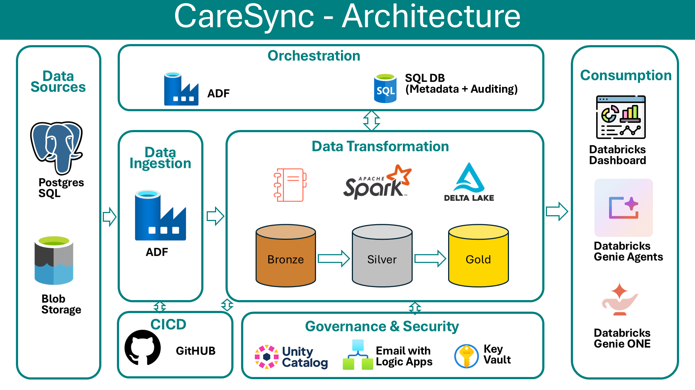

# CareSync Azure Data Engineering Platform

End-to-end Azure data engineering project demonstrating scalable ingestion, incremental processing, medallion architecture, governance, and analytics using the Microsoft Azure and Databricks ecosystems.

> 🚧 **Project Status: In Development**

## Overview

CareSync is a portfolio data engineering project that models how synthetic healthcare data can move from operational source systems into an analytics-ready Azure lakehouse.

The platform combines:

- **PostgreSQL** for relational source data
- **Azure Blob Storage / ADLS Gen2** for file-based sources and lake storage
- **Azure Data Factory** for ingestion and orchestration
- **Azure SQL Database** for pipeline metadata and auditing
- **Azure Databricks** and **Apache Spark** for distributed transformations
- **Delta Lake** for Bronze, Silver, and Gold data layers
- **Azure Key Vault** for secrets management
- **Databricks Unity Catalog** for governance
- **GitHub** for source control and CI/CD

The project is being implemented incrementally. Source data, Azure Data Factory Git integration, and initial ingestion components are in development. Databricks transformations, Delta Lake processing, governance, monitoring, and consumption components will be added progressively.

All healthcare records used in this project are synthetic and intended only for development and demonstration. No real patient or production healthcare data is used.

---

## Architecture



The diagram represents the **target CareSync architecture**. Components are being implemented incrementally and should only be considered complete when marked as completed in the [Implementation Status](#implementation-status) section.

### Data Flow

```text
PostgreSQL / File Sources
           |
           v
   Azure Data Factory
           |
           v
  Blob Storage / ADLS Gen2
           |
           v
      Bronze Layer
           |
           v
 Azure Databricks
 Apache Spark + Delta Lake
           |
           v
      Silver Layer
           |
           v
       Gold Layer
           |
           v
 Databricks Analytics
```

### Architecture Layers

1. **Data Sources**
   - PostgreSQL operational data
   - CSV and file-based data stored in Azure Blob Storage

2. **Orchestration**
   - Azure Data Factory for ingestion and workflow orchestration
   - Azure SQL Database for metadata, control tables, and pipeline auditing

3. **Data Ingestion**
   - Azure Data Factory pipelines for relational and file-based ingestion
   - Initial-load and incremental-load patterns

4. **Data Transformation**
   - Azure Databricks
   - Apache Spark and PySpark
   - Delta Lake
   - Bronze, Silver, and Gold processing layers

5. **Governance and Security**
   - Azure Key Vault
   - Databricks Unity Catalog
   - Auditing and metadata
   - Operational email notifications using Azure Logic Apps

6. **Consumption**
   - Databricks dashboards
   - Databricks Genie experiences
   - Analytics-ready Gold datasets

7. **CI/CD**
   - GitHub-based source control
   - Versioned Azure Data Factory and Databricks artifacts
   - Future automated deployment workflows

---

## Technology Stack

| Area | Technology | Status |
|---|---|---|
| Cloud platform | Microsoft Azure | In Use |
| Relational source | PostgreSQL | Implemented |
| File sources | CSV / Azure Blob Storage | Implemented |
| Orchestration | Azure Data Factory | In Progress |
| Pipeline metadata | Azure SQL Database | In Progress |
| Data lake | ADLS Gen2 | In Progress |
| Processing | Azure Databricks | Planned |
| Distributed processing | Apache Spark / PySpark | Planned |
| Lakehouse storage | Delta Lake | Planned |
| Architecture | Bronze / Silver / Gold | Planned |
| Secrets management | Azure Key Vault | Planned |
| Governance | Databricks Unity Catalog | Planned |
| Notifications | Azure Logic Apps | Planned |
| Analytics | Databricks Dashboards | Planned |
| Source control | Git / GitHub | Implemented |
| Languages | SQL, Python | In Use |

---

## Data Sources

CareSync models a small healthcare analytics environment using synthetic data.

### PostgreSQL

PostgreSQL represents the operational relational source.

The source model includes entities such as:

- Hospitals
- Doctors
- Patients

The project contains SQL scripts for:

- Creating the source schema
- Creating relational tables
- Generating synthetic records
- Inserting new records
- Updating existing records
- Simulating source-system changes over time

These changes provide realistic scenarios for initial and incremental ingestion.

### File-Based Sources

File-based sources provide additional datasets such as:

- Insurance-provider reference data
- Laboratory-result events

Initial-load and incremental-load CSV files are maintained separately to simulate data arriving over time.

No real patient or clinical information is used.

---

## Azure Data Factory

Azure Data Factory is the primary ingestion and orchestration service.

ADF development is maintained in a dedicated Git-integrated repository:

**ADF Repository:**  
[yousseffwaleed/caresync_adf_repo](https://github.com/yousseffwaleed/caresync_adf_repo)

The ADF repository contains native Azure Data Factory artifacts such as:

```text
dataset/
factory/
linkedService/
pipeline/
publish_config.json
```

The repositories are intentionally separated:

```text
caresync_adf_repo
├── ADF Git integration
├── Pipeline definitions
├── Dataset definitions
├── Linked services
└── Factory configuration

caresync_azure_project
├── Project documentation
├── Architecture
├── Source SQL
├── Metadata SQL
├── Databricks code
├── Data models
└── Implementation guides
```

This separation allows Azure Data Factory to maintain its native Git integration while this repository serves as the portfolio-facing representation of the complete platform.

### ADF Capabilities

The ADF implementation is being developed around reusable pipeline patterns rather than independent pipelines for every source.

The target implementation includes:

- PostgreSQL ingestion
- CSV and file ingestion
- Linked services
- Reusable datasets
- Copy activities
- Lookup activities
- ForEach processing
- Parameterized pipelines
- Metadata-driven execution
- Initial full loads
- Incremental loads
- Pipeline dependencies
- Failure handling
- Pipeline monitoring
- Audit logging

---

## Metadata and Auditing

The architecture includes an Azure SQL Database for pipeline configuration, metadata, and auditing.

### Metadata

The metadata layer is intended to store configuration such as:

- Source system
- Source schema
- Source table
- Target path
- File format
- Load strategy
- Watermark column
- Previous successful watermark
- Pipeline activation status

This design allows multiple sources to use reusable ingestion pipelines rather than requiring source-specific pipeline logic.

### Auditing

The audit layer is intended to capture:

- Pipeline name
- Pipeline run identifier
- Source entity
- Start timestamp
- End timestamp
- Execution status
- Source row count
- Target row count
- Watermark value
- Error details

This supports pipeline observability, troubleshooting, and reconciliation.

---

## Incremental Data Loading

A major goal of CareSync is to avoid unnecessary full-source reloads.

The target incremental-ingestion design uses metadata and watermark-based processing:

```text
Read Previous Watermark
          |
          v
Identify New or Changed Records
          |
          v
ADF Incremental Extraction
          |
          v
ADLS Gen2 Bronze Layer
          |
          v
Databricks Processing
          |
          v
Delta Lake MERGE
          |
          v
Update Successful Watermark
```

This pattern allows the platform to process records inserted or to support multiple source tables through a reusable, metadata-driven ADF framework.

---

## Medallion Architecture

CareSync follows a Bronze, Silver, and Gold data architecture.

### Bronze Layer

The Bronze layer stores raw ingested data with minimal modification.

Responsibilities include:

- Preserving source data
- Initial-load ingestion
- Incremental ingestion
- Historical traceability
- Ingestion metadata
- Minimal source transformation

### Silver Layer

The Silver layer contains cleaned, validated, and standardized data.

Processing will include:

- Schema enforcement
- Data type normalization
- Null handling
- Deduplication
- Data-quality validation
- Standardization
- Business-rule transformations
- Conformed healthcare entities

### Gold Layer

The Gold layer contains analytics-ready datasets.

Gold datasets are intended to support:

- Analytical queries
- Business reporting
- Aggregated metrics
- Curated healthcare entities
- Databricks dashboards
- AI-assisted analytics experiences

---

## Azure Databricks

Azure Databricks is the planned transformation and lakehouse-processing layer.

Project code is organized by medallion layer:

```text
databricks/
├── bronze/
├── silver/
└── gold/
```

The planned Databricks implementation will use **PySpark** and **Delta Lake** for:

- Reading Bronze data
- Schema validation
- Data cleansing
- Data standardization
- Deduplication
- Data-quality validation
- Incremental processing
- Delta Lake `MERGE` operations
- Silver-layer transformations
- Gold-layer business models

The Databricks implementation is currently under development. The repository will be updated as notebooks and source files are completed.

---

## Security and Governance

CareSync is designed so that credentials are not embedded directly in pipelines, notebooks, SQL files, or application code.

### Azure Key Vault

Azure Key Vault is planned for centralized management of:

- Database credentials
- Storage credentials
- Service secrets
- Connection information

### Databricks Unity Catalog

Unity Catalog is planned for:

- Centralized data governance
- Catalog and schema organization
- Access control
- Data discovery
- Auditable permissions

### Security Principles

The project follows these principles:

- Never commit credentials or tokens
- Keep secrets outside source code
- Use least-privilege access
- Use managed identities where appropriate
- Separate environment configuration from processing logic
- Maintain auditable access to data assets

> **Security Notice:** Passwords, keys, connection strings, SAS tokens, access tokens, and other secrets must not be committed to this repository.

---

## Monitoring and Reliability

The target platform includes production-oriented monitoring and reliability patterns.

Planned capabilities include:

- ADF pipeline monitoring
- Activity-level failure handling
- Retry strategies
- Pipeline execution logging
- Source and target row counts
- Record-count reconciliation
- Incremental-load verification
- Data-quality validation
- Audit logging
- Operational email notifications
- Diagnostic information for failed pipeline runs

Azure Logic Apps is planned for sending notifications about pipeline failures and operational events.

---

## Analytics and Consumption

Gold-layer data is intended to support Databricks-based analytics.

The target consumption layer includes:

- Databricks dashboards
- Databricks SQL analytics
- Databricks Genie experiences
- Curated Gold-layer datasets
- Business-facing analytical queries

These components are part of the target architecture and will be added after the ingestion and transformation layers are operational.

---

## CI/CD and Source Control

GitHub is used for project source control and versioning.

Azure Data Factory uses a dedicated Git-integrated repository, while this repository contains the broader platform implementation and documentation.

The target CI/CD workflow will support:

- Version-controlled ADF artifacts
- Version-controlled Databricks code
- Pull-request review
- Environment-specific configuration
- Automated validation
- Controlled deployment across environments

CI/CD automation is planned and is not currently marked as complete.

---

## Repository Structure

```text
caresync_azure_project/
│
├── README.md
│
├── architecture/
│   └── architecture-overview.png
│
├── databricks/
│   ├── bronze/
│   ├── silver/
│   └── gold/
│
├── sql/
│   ├── source/
│   ├── metadata/
│   └── gold/
│
├── sample-data/
│
└── docs/
```

### Directory Guide

| Directory | Purpose |
|---|---|
| `architecture/` | Architecture diagrams and platform designs |
| `databricks/bronze/` | Raw-data ingestion and Bronze processing |
| `databricks/silver/` | Cleansing, validation, and standardization |
| `databricks/gold/` | Analytics-ready transformations |
| `sql/source/` | PostgreSQL setup and source transactions |
| `sql/metadata/` | Pipeline metadata and audit-table SQL |
| `sql/gold/` | Analytics-serving models and queries |
| `sample-data/` | Synthetic demonstration datasets |
| `docs/` | Setup and implementation documentation |

---

## Design Principles

### Reusable Ingestion

Build reusable data-ingestion pipelines instead of maintaining one pipeline for every source table.

### Incremental Processing

Process new and changed records whenever possible rather than repeatedly performing full reloads.

### Separation of Concerns

Use Azure Data Factory for orchestration and data movement while Azure Databricks handles distributed transformation and lakehouse processing.

### Medallion Architecture

Separate raw, validated, and business-ready data into Bronze, Silver, and Gold layers.

### Metadata-Driven Engineering

Store source-specific configuration in metadata instead of hard-coding pipeline behavior.

### Secure Configuration

Keep authentication credentials and secrets outside source code.

### Data Quality

Validate data as it moves through the platform rather than relying on downstream reports to identify problems.

### Observability

Make ingestion failures, transformation issues, and data-quality problems diagnosable through metadata, auditing, and monitoring.

### Source Control

Maintain platform artifacts through Git-based development workflows.

---

## Implementation Status

### Completed

- [x] Main project repository initialized
- [x] Architecture overview created
- [x] Azure Data Factory Git integration established
- [x] PostgreSQL source environment created
- [x] Synthetic healthcare source data created
- [x] File-based source scenarios created
- [x] Initial source-ingestion development started

### In Progress

- [ ] Reusable ADF pipelines
- [ ] Parameterized pipeline design
- [ ] Metadata-driven ADF framework
- [ ] Incremental and watermark loading
- [ ] ADLS Gen2 Bronze ingestion
- [ ] Azure SQL metadata and audit layer

### Planned

- [ ] Azure Key Vault integration
- [ ] Databricks Bronze processing
- [ ] Databricks Silver transformations
- [ ] Delta Lake incremental processing
- [ ] Gold-layer data model
- [ ] Data-quality framework
- [ ] Unity Catalog governance
- [ ] Monitoring and error handling
- [ ] Logic Apps notifications
- [ ] Databricks consumption layer
- [ ] CI/CD automation
- [ ] End-to-end deployment documentation

The checklist will be updated only after each component is implemented and validated.

---

## Key Learning Objectives

CareSync is being developed to strengthen hands-on experience with:

- Azure Data Factory
- Azure Data Lake Storage Gen2
- Azure Databricks
- Apache Spark and PySpark
- Delta Lake
- Azure SQL Database
- Azure Key Vault
- Databricks Unity Catalog
- Batch ingestion
- Incremental ingestion
- Metadata-driven pipelines
- Medallion architecture
- Data-quality engineering
- Pipeline monitoring
- Data-platform security
- Git-based development
- CI/CD
- Production-oriented Azure data engineering

---

## Disclaimer

CareSync is a personal data engineering project created for educational and portfolio purposes.

All healthcare records used by the project are synthetic demonstration data. This repository does not contain real patient, clinical, employer, or client data.

Services represented in the target architecture should not be assumed to be fully implemented unless they are marked as completed in the **Implementation Status** section.